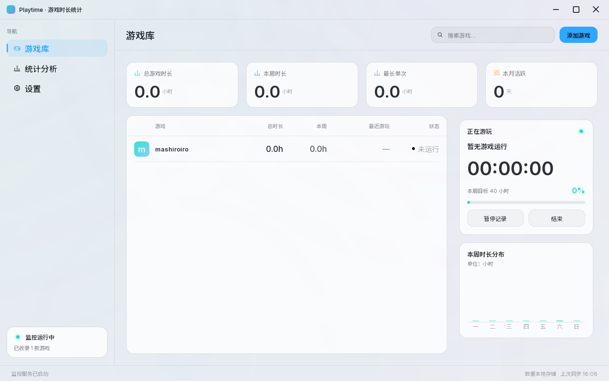
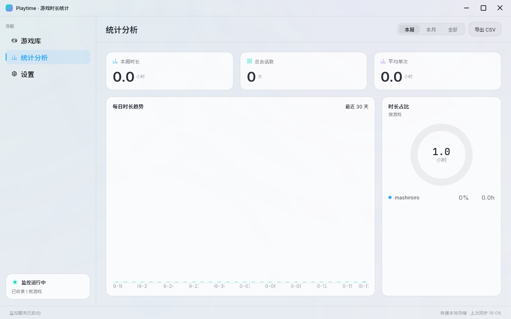
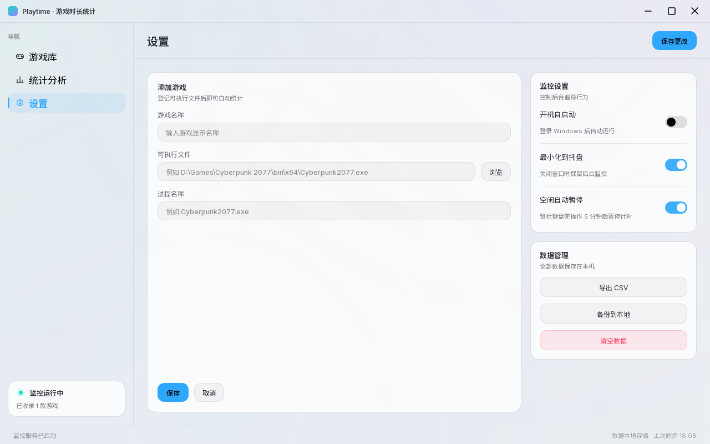

# Playtime · 游戏时长统计

Windows 桌面端的游戏时长统计工具：登记游戏的可执行文件后，后台自动监听进程、累计每次游玩时长，
并按周 / 月 / 全部维度统计。纯本地运行，不联网、不上传任何数据。



## 功能

**游戏库**

- KPI：总游戏时长、本周时长、最长单次、本月活跃天数
- 游戏列表：封面色块、总时长、本周、最近游玩、运行状态，支持按名称搜索
- 「正在游玩」：`HH:MM:SS` 实时计时、本周目标进度，可暂停 / 结束本次记录
- 「本周时长分布」：周一至周日柱状图，高亮今天

**统计分析**

- 本周 / 本月 / 全部 三种范围切换
- 最近 30 天每日时长趋势、按游戏的时长占比环形图
- 一键导出 CSV（UTF-8 BOM，Excel 直接打开）

**设置**

- 添加游戏：浏览 exe 自动带出进程名
- 开机自启动、最小化到托盘、空闲自动暂停
- 数据导出 / 备份到本地 / 清空数据

**进程监控**

- 用 Toolhelp32 枚举进程（不依赖 psutil），每 3 秒扫描一次
- 进程出现自动开始计时、退出自动落盘，少于 5 秒的会话直接丢弃
- 鼠标键盘无操作超过设定时长自动暂停，恢复输入后继续计时

## 下载

当前版本：**v1.0.1**

| 方式 | 说明 |
| --- | --- |
| [Release](https://github.com/SakuraMat0u/playtime/releases) | 下载 `Playtime_x64.zip`（约 53 MB），解压后双击 `Playtime.exe`，无需安装 Python |
| 从源码运行 | `pip install -r requirements.txt` 后 `python main.py`，见下一节 |

> 仓库只保留源码与资源；`dist/`、`build/`、`release/`、`__pycache__/` 都在 `.gitignore` 里，
> 打包产物通过 GitHub Release 分发，克隆仓库不会拖上百 MB 二进制。

## 从源码运行

```bash
pip install -r requirements.txt
python main.py
```

要求 Windows 10 / 11 64 位。已在 Python 3.13 + PySide6 6.12 上验证，
程序依赖 `winreg`、`user32.GetLastInputInfo` 等 Windows 专属 API，不支持其它平台。

## 使用

1. 打开「设置」→ 填写游戏名称、选择游戏的可执行文件（进程名会自动带出）→ 保存
2. 回到「游戏库」，启动游戏后会自动开始计时
3. 本周目标、空闲暂停阈值等可在设置中调整

数据位置：

- **从源码运行**：`%LOCALAPPDATA%\Playtime\data.json`
- **发布包**：程序目录下的 `userconfig\data.json`，整个文件夹拷走即可换机

## 界面

| 游戏库 | 统计分析 | 设置 |
| --- | --- | --- |
|  |  |  |

## 项目结构

```
playtime/
├─ main.py            # 入口：无边框窗口、导航、托盘、开机自启、单实例锁
├─ app/
│  ├─ theme.py        # 设计令牌：配色 / 圆角 / 字体 / 全局样式 / qcolor
│  ├─ icons.py        # 24×24 网格描边图标（QPainterPath 自绘）
│  ├─ charts.py       # 极光背景、柱状图、环形图、进度条、状态点、渐变瓦片
│  ├─ widgets.py      # 卡片、KPI、导航项、开关、窗口按钮、公共布局助手
│  ├─ components.py   # 界面通用组件：搜索框 / 分段切换 / 游戏行 / 表格 / 表单字段
│  ├─ shell.py        # 标题栏、侧边栏、状态栏
│  ├─ screens.py      # 三个界面：游戏库 / 统计分析 / 设置
│  ├─ storage.py      # JSON 读写、统计计算、CSV 导出、进行中会话周期落盘
│  └─ monitor.py      # 进程监控线程、Toolhelp32 枚举、空闲检测
├─ assets/            # 应用图标与随包字体（Inter / JetBrains Mono / Noto Sans SC）
├─ preview/           # 界面截图（由 tools/render_previews.py 离屏生成）
├─ tools/             # 发布用启动器源码与编译脚本、预览图渲染脚本
├─ build.bat          # PyInstaller 打包脚本
├─ requirements.txt   # 源码运行的依赖（PySide6）
└─ version_info.txt   # exe 版本资源
```

## 打包

```bash
build.bat                     # 目录版：dist\Playtime\{Playtime.exe, files\}
tools\build_launchers.bat     # 生成发布用的两个启动器
```

发布包结构、DLL 完整性校验、SmartScreen 提示的处理方式等，见
[打包与发布说明](docs/PACKAGING.md)。

## 已知限制

- 游戏只能新增，暂不支持在界面里编辑或删除单款游戏（可用「清空数据」重来）
- 监控按进程名匹配；通过 Steam / Epic 等启动器启动、进程名与 exe 名不一致的游戏需要手工填对
- 同一时刻只展示一个「正在游玩」游戏
- 本周目标（40 小时）与空闲阈值（5 分钟）目前只能改 JSON
- 跨天/跨周边界的会话按天拆分归属，但一次会话在「最长单次」「总会话数」里仍按整段计算

## 更新记录

**v1.0.1**（2026-10-18）

- 修复：`data.json` 带 UTF-8 BOM 时被误判为损坏、回退成空库，导致游戏列表和计时全部"消失"
- 新增：进行中的会话每 3 秒增量落盘，崩溃或强杀最多丢失一个扫描周期
- 新增：按数据目录的单实例互斥，避免多开互相覆盖数据
- 新增：匹配不到进程时写 `userconfig\monitor.log`，便于排查「一直等待游戏启动」
- 调整：界面组件拆分到 `app/components.py`，`screens.py` 精简约 300 行
- 调整：`_render.py` 迁移为 `tools/render_previews.py`，新增 `requirements.txt`

**v1.0.0**（2026-10-17）

- 首个版本：游戏库 / 统计分析 / 设置三个界面，Toolhelp32 进程监控，
  便携数据目录 `userconfig\`，双启动器发布包

## 许可

源码采用 [MIT License](LICENSE)。
随包分发的 Qt / PySide6 为 LGPLv3，Inter / JetBrains Mono / Noto Sans SC 为 SIL Open Font License 1.1。
